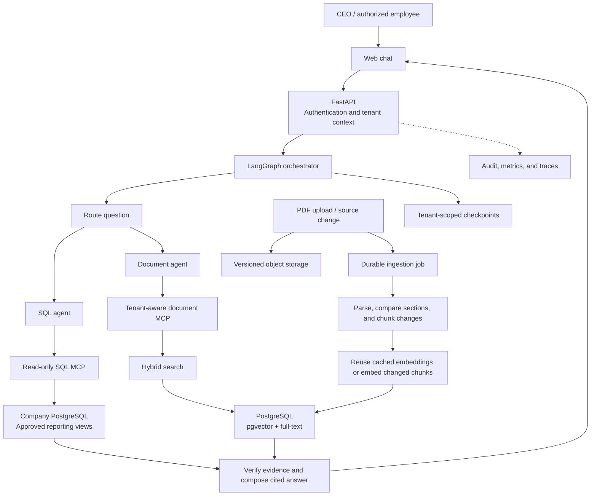

# HR Intelligence Platform

A multi-tenant AI assistant for company leaders. Ask questions in plain English and get evidence-grounded answers from business data and company documents.

> **Project status:** Planning and early development. The repository currently contains the project README; the architecture below describes the intended implementation.

## What it will do

- Answer questions using read-only SQL analytics, company documents, or both.
- Cite document sources and explain the evidence behind results.
- Route work through a bounded LangGraph workflow with specialized planning, SQL, retrieval, and answer steps.
- Connect tools through MCP, including a tenant-aware document server and a restricted PostgreSQL server.
- Process PDF uploads incrementally: unchanged sections reuse existing chunks and embeddings.
- Keep company data isolated with tenant-aware authorization across queries, documents, jobs, and agent state.
- Evaluate answer quality and safety before release and monitor behavior in production.

## Architecture

## Data freshness and incremental indexing

The ingestion pipeline identifies a document by stable source ID, checks its content hash, and parses changed files to find modified sections. It reuses chunks and embeddings for unchanged text, then stages and atomically publishes the new document version. A failed job leaves the previous complete version active.

New rows in a connected business database are queried directly; they do not trigger document re-indexing. Records explicitly selected for document retrieval can use record-level change events. Schema changes require a schema catalog refresh.

A changed PDF may need to be parsed again to find what changed. The goal is to avoid re-chunking and re-embedding unchanged content, not to promise that every source can be diffed without reading it.

## Planned technology

- **API:** Python and FastAPI
- **Agent orchestration:** LangGraph
- **Storage and search:** PostgreSQL, pgvector, and PostgreSQL full-text search
- **Jobs:** PostgreSQL-backed durable job table and background workers for the pilot
- **MCP:** Official Python SDK with custom, least-privilege servers
- **Local development:** Docker Compose, PDF uploads, and sample PostgreSQL data
- **Production direction:** Private object storage, authenticated HTTPS, managed PostgreSQL, backups, and monitored workers
- **Models:** Configurable hosted LLM and embedding APIs

Connector subscriptions are not required for the initial PDF and sample PostgreSQL prototype. Hosted model APIs and production hosting may have costs.

## Security principles

- Derive tenant identity from authenticated requests; never trust a model-generated tenant ID.
- Enforce authorization in the API, retrieval layer, MCP tools, and database permissions.
- Use dedicated read-only database credentials and approved reporting views.
- Validate generated SQL, apply timeouts and result limits, and reject writes.
- Treat retrieved documents and tool outputs as untrusted input.
- Redact secrets and sensitive content from logs; keep an audit trail for tool use.
- Apply deletions and permission revocations to retrieval immediately, with physical cleanup handled asynchronously.

## Development status

The implementation is planned in phases:

1. Tenant-aware foundation, local development environment, PDF upload, and read-only SQL MCP.
2. LangGraph question workflow, hybrid retrieval, citations, and incremental ingestion.
3. Authorization hardening, retries, auditability, evaluations, and production readiness.

## Evaluation

The project will maintain a versioned set of representative questions with expected SQL results, relevant document passages, and expected clarification or refusal behavior. Pre-release checks will cover SQL correctness, retrieval quality, citation accuracy, groundedness, routing, prompt injection, and cross-tenant isolation. Production monitoring will track ingestion lag, errors, latency, tool failures, and model cost.

## Repository

Implementation issues and milestones are tracked in the [Linear project](https://linear.app/dev-rajyaguru/project/hr-intelligence-platform-3b2868bd81e7).
